# VibeSDR

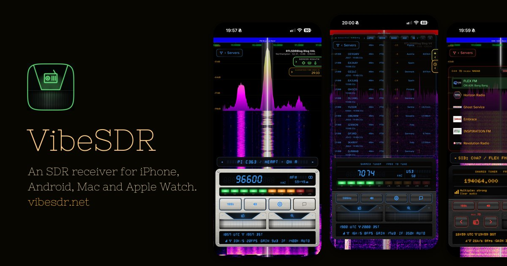

A whole SDR ecosystem built for one hand: a receiver for iPhone, iPad,
Mac, Android and Apple Watch with its own DSP, and **VibeServer**, which shares your radio with the
world from a Raspberry Pi, a Mac, a Linux box, a spare Android phone or even a television.

**[Try the live Buzzer on vibesdr.net](https://vibesdr.net)**: a real recording of UVB-76 on
4625 kHz, drawn by the same waterfall code as the web client. Pick a palette and hear it.

---

# 📻 [→ Browse live receivers](https://vibeserver.vibesdr.net)

### Real radios, shared by real people. Nothing to install: open it and tune.

## 🛜 [→ Share yours](#share-your-radio)

**Every receiver on that list is somebody's spare radio.** A Raspberry Pi, an old Android phone, a
Linux box in a drawer, a TV box: plug a dongle in, run VibeServer, and anyone can listen from a
browser. It takes about five minutes, and the more of us who do it, the better the map gets.

---

### Get it

| | |
|---|---|
| 📱 **[VibeSDR on the App Store](https://apps.apple.com/gb/app/vibesdr/id6786344049)** | iPhone, iPad and Apple Silicon Macs, with the Apple Watch remote (Buddy) included. |
| ⌚ **[VibeSDR Jr on the App Store](https://apps.apple.com/gb/app/vibesdr-jr/id6795507029)** | The standalone Apple Watch receiver: its own connection, its own audio, no phone. |
| 🤖 **[Android APK](https://github.com/Stuey3D/VibeSDR/releases)** | VibeSDR for Android, straight from GitHub. No Google account needed, and registered to a verified developer, so it installs without the 24-hour wait Android now puts on apps from unverified ones. |
| 🖥 **[VibeServer](#share-your-radio)** | `apt` for Linux, a notarised Mac app, Raspberry Pi card images, and VibeServer Lite for Android. |
| 💬 **[Discord](https://discord.gg/pr9EjUUBCA)** | Where the testing, the bug reports and the DX chat happen. |
| 🌐 **[vibesdr.net](https://vibesdr.net)** · **[demo receiver](https://demo.vibesdr.net)** | The site, and our own radio to try right now. |

Building it yourself is free, forever. The App Store price covers Apple's fees; it is not a paywall.

---

## What it is

Four things that share one DSP engine and one design:

- **The app.** iPhone, iPad, Mac and Android. Tune a shared receiver, or plug a radio straight into
  an Android phone and run the whole receiver on the handset.
- **The watch.** The live spectrum drawn *on the watch*, tuned with the Digital Crown: **Buddy**, a
  remote for the phone, or **Jr**, a standalone receiver with its own connection and audio.
- **VibeServer.** Turns a Raspberry Pi, a Linux box, a Mac, an Android phone or an Android TV into a
  receiver anyone can listen to. Roughly 25× lighter on the wire than raw `rtl_tcp`.
- **The web client.** Served by VibeServer itself. No install, any modern browser.

It speaks **UberSDR**, **OpenWebRX / OpenWebRX+**, **KiwiSDR**, **FM-DX Webserver**, **SpyServer**,
plain **rtl_tcp**, and its own VibeServer protocol.

## What actually sets it apart

Most SDR clients are a socket and a picture: they ask the server for a waterfall image, put it on
screen, and tune with a slider. VibeSDR is not in that category.

- **It renders its own waterfall** from raw FFT bins in a GPU shader, synthesising the lines between
  data frames and repainting your whole history the instant you change a palette.
- **It demodulates on the device.** VibeDSP is a clean-room DSP engine written from scratch (no
  SDR++, no FFTW, no VOLK): true Weaver SSB, FM stereo with a 19 kHz pilot PLL, RDS, MMSE noise
  reduction, and its own DAB receiver.
- **The tuning is a flywheel with mass**, with detents and speed-adaptive haptics, not a slider.
  Prefer buttons? The keys scheme steps with a click and sweeps when held, like a nineties car tuner.
- **The front panel is yours.** A chassis in the original style, brushed silver or black metal; a
  frequency display as Nixie tubes, a VCR-style dot-matrix, 14-segment glass or the classic readout;
  a signal meter as a bar, an LED VU strip or a lamp-lit analogue needle; and 26 waterfall palettes.
- **The waterfall runs on your wrist.** Not media buttons: the real spectrum, about a third of one
  CPU core, with the phone locked in your pocket.
- **It goes low.** A 2015 Raspberry Pi 2 hosts a server, and a 1 GB Android Go handset runs the client.

Judge it on the feel. That's the part a screenshot can't show, and the part we care most about.

## Screenshots

**On a phone**

| 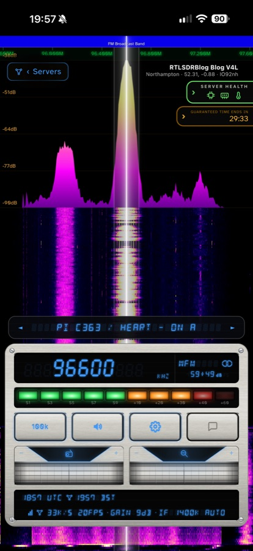 | 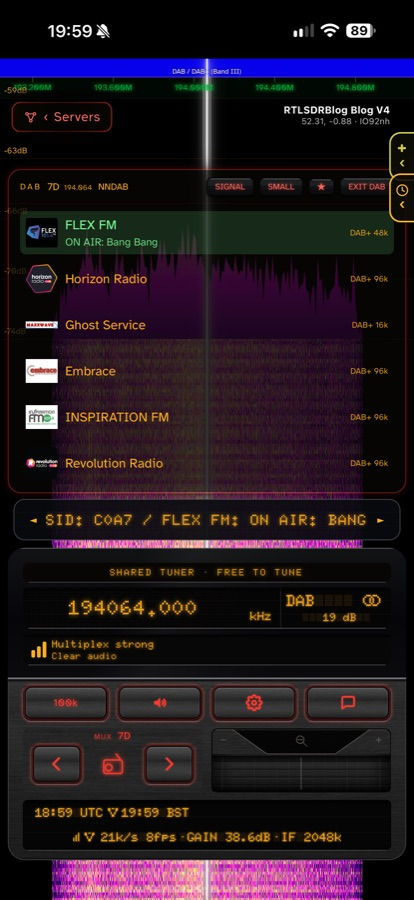 | 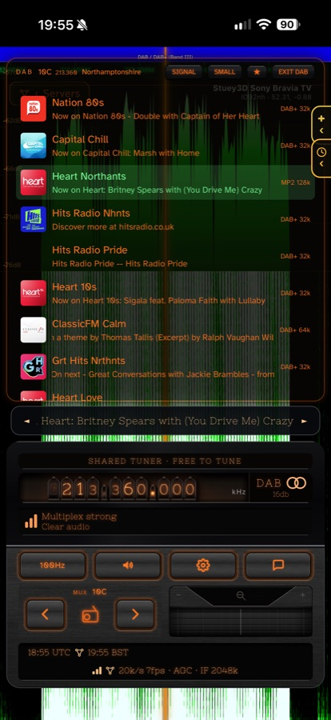 |
|:---:|:---:|:---:|
| *Silver faceplate, blue display, FM* | *Red display, DAB 7D with station logos* | *Nixie tubes, DAB 10C* |
| 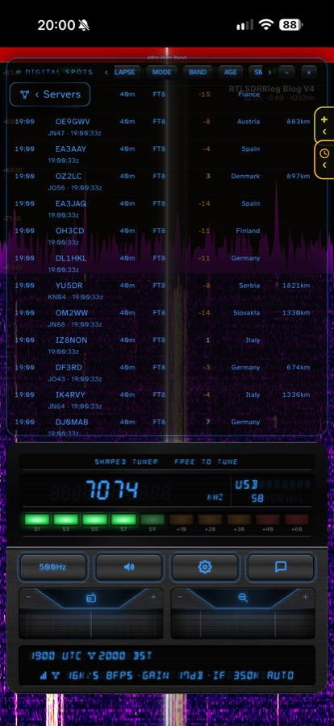 | 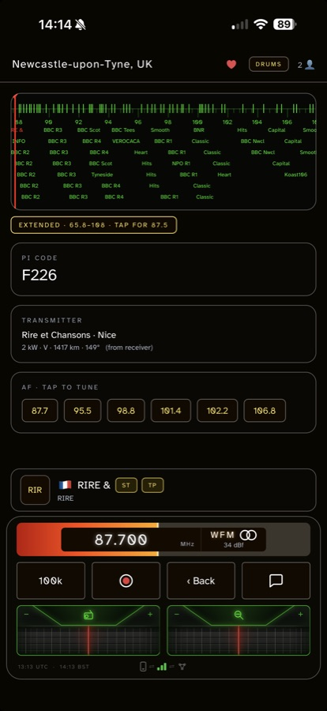 | 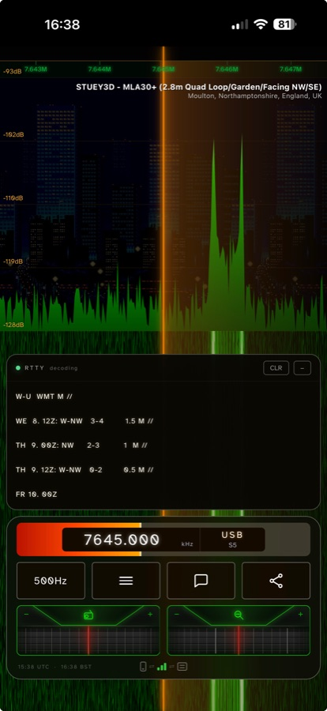 |
| *FT8 spots on 40 m* | *FM-DX tuner with RDS* | *RTTY decoder* |
| 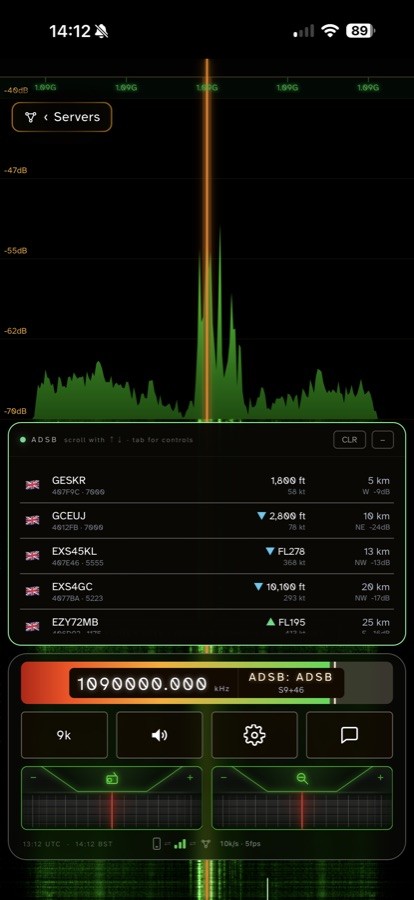 | 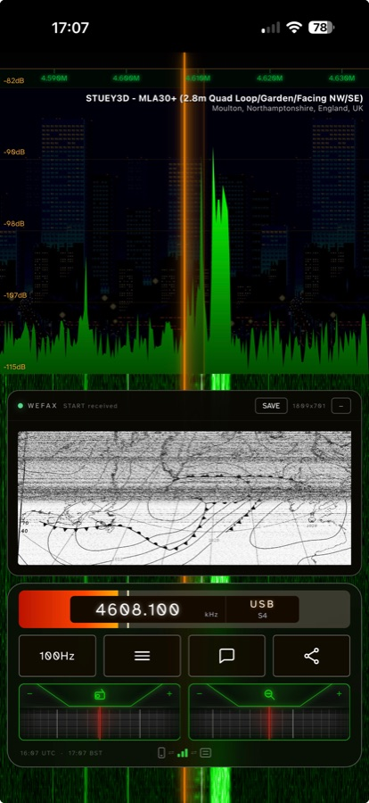 | 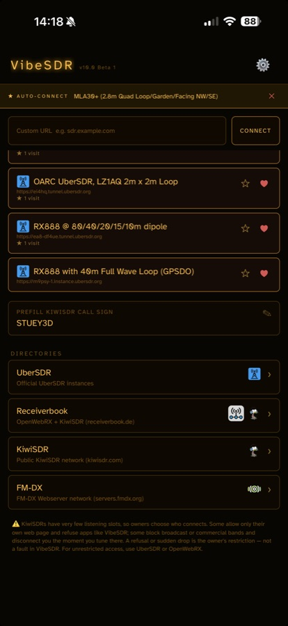 |
| *ADS-B aircraft, decoded by an OpenWebRX server* | *WEFAX weather chart* | *Servers and directories* |

**On a Mac**

| 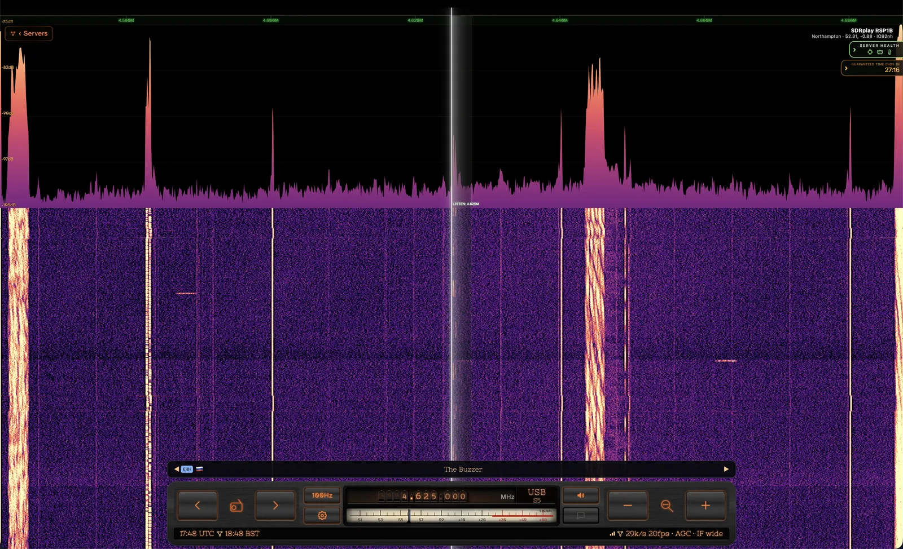 | 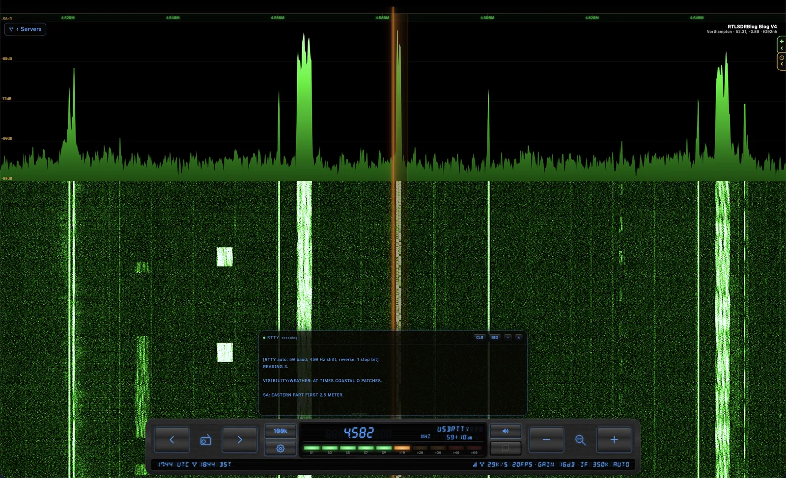 |
|:---:|:---:|
| *Nixie tubes and a lamp-lit needle on The Buzzer* | *14-segment glass, LED VU strip, RTTY* |
| 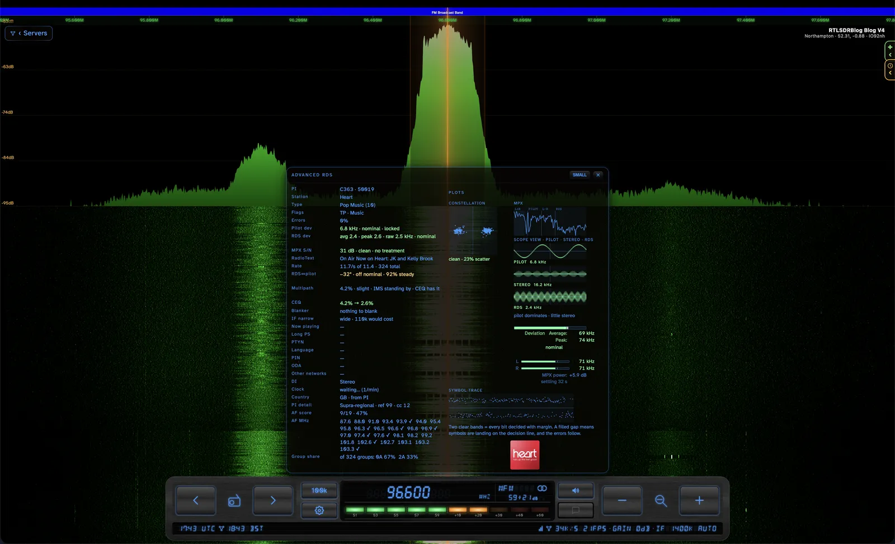 | 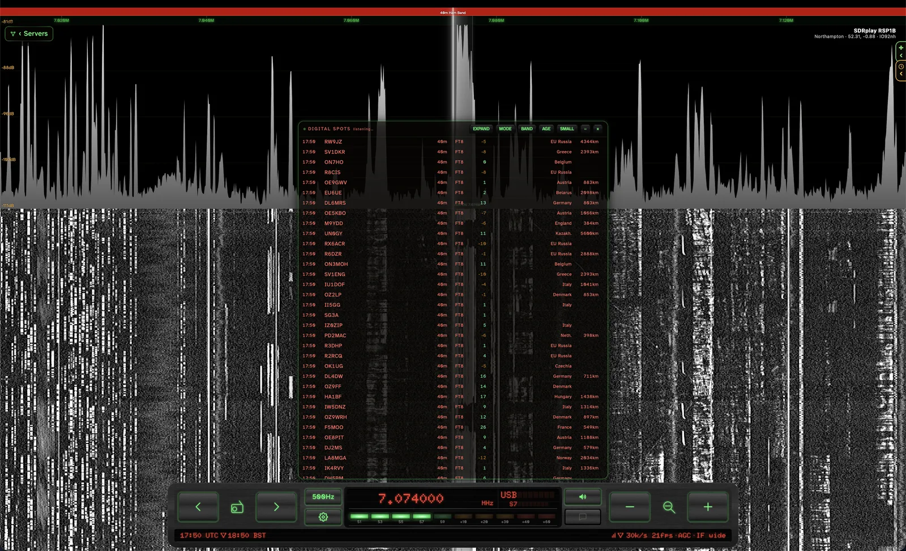 |
| *Advanced RDS: deviation, MPX S/N, constellation* | *Red on black, greyscale waterfall, FT8* |

**On the Apple Watch**

| 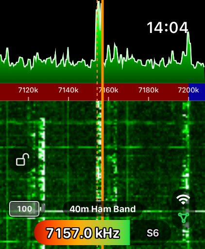 | 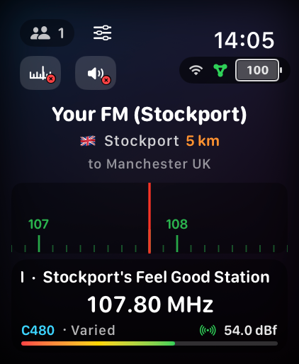 | 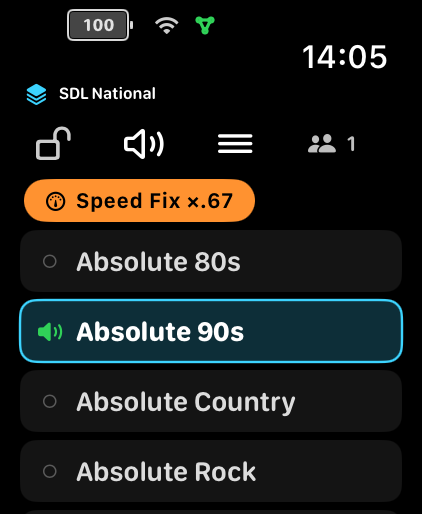 | 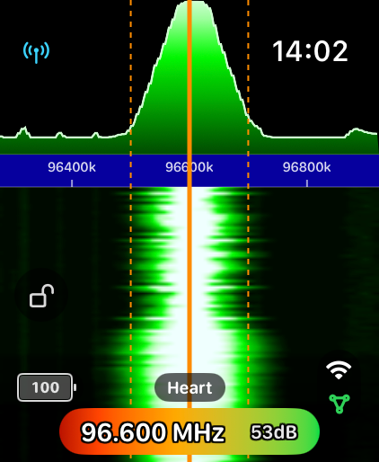 | 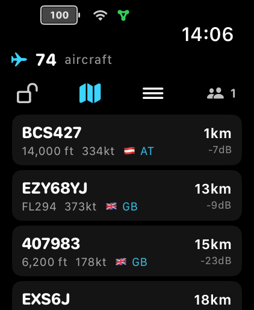 |
|:---:|:---:|:---:|:---:|:---:|
| *40 m, tuned with the Crown* | *An FM-DX server, with RDS* | *DAB services* | *FM waterfall on OpenWebRX or VibeServer* | *ADS-B aircraft, decoded by an OpenWebRX server* |

## Share your radio

**VibeServer** shares one or more receivers with anyone who has a browser: server-side DSP, Opus
audio, Advanced RDS, DAB and DAB+, the decoders, an optional PIN, per-band gain ceilings and session
limits. Several radios can sit behind one address.

**Linux** (arm64, amd64 and armhf):

```bash
curl -fsSL https://apt.vibesdr.net/KEY.gpg \
  | sudo gpg --dearmor -o /usr/share/keyrings/vibesdr.gpg
echo "deb [arch=arm64,amd64,armhf signed-by=/usr/share/keyrings/vibesdr.gpg] https://apt.vibesdr.net stable main" \
  | sudo tee /etc/apt/sources.list.d/vibesdr.list
sudo apt update && sudo apt install vibeserver
```

**Raspberry Pi, ready to boot.** VibeServer Portable is a card image from
[the releases](https://github.com/Stuey3D/VibeSDR/releases): 64-bit for the Pi 3, 4, 5, Zero 2 W and
500, 32-bit down to a Pi 2. Flash it, join the **VibeServer** hotspot it raises, and set it up from
your phone, or plug in a cable and open `http://vibeserversetup.local:48000`. It updates itself from
the admin page; a new card is only for a new box.

**macOS.** A notarised menu-bar app for Apple Silicon, from
[the releases](https://github.com/Stuey3D/VibeSDR/releases). Unzip, drag to Applications.

**Android.** In the app, plug in the radio and tap **Use as server**. For a box that does nothing
else, **VibeServer Lite** is the server on its own for Android TV boxes, old phones and tablets
(Android 5.0 and up, ARM), also in [the releases](https://github.com/Stuey3D/VibeSDR/releases).

| 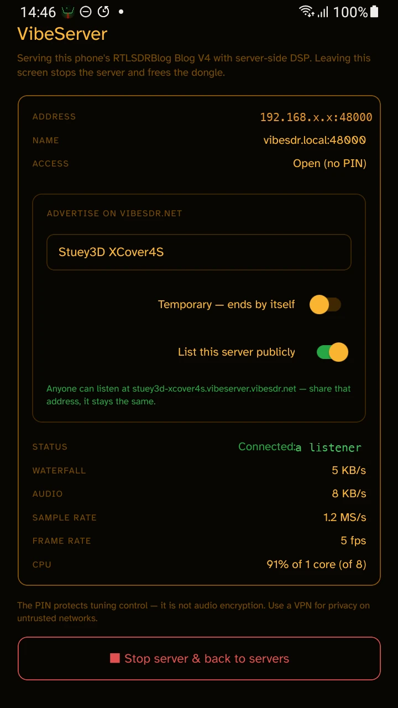 |
|:---:|
| *A rugged 2019 Android phone and a £30 dongle, serving to the world: a listener connected, 8 KB/s of audio, and a public address that stays the same.* |

**Radios:**

| Radio | Linux · macOS | Android |
|---|:---:|:---:|
| **RTL-SDR**: the usual dongles, including the Blog V4 and V4L | ✅ | ✅ |
| **Airspy HF+**: Discovery and Dual Port | ✅ | ✅ |
| **Airspy R2 / Mini** | ✅ | ✅ |
| **HackRF One** | ✅ | ✅ |
| **SDRplay RSP**: needs SDRplay's own API installed | ✅ | ✕ |

**SDRplay is desktop-only** because the RSP API is SDRplay's closed-source library and there is no
Android build of it. On a phone, use one of the others. The **HackRF** and **Airspy R2 / Mini**
drivers were proven with testers who own them (see [Credits](#credits)) rather than on hardware
here, and reports are always welcome.

Optionally publish your receiver to the [public directory](https://vibeserver.vibesdr.net) through
a Cloudflare tunnel. Your home address is never exposed.

…and this is what the listener gets, in a browser, with nothing installed:

| 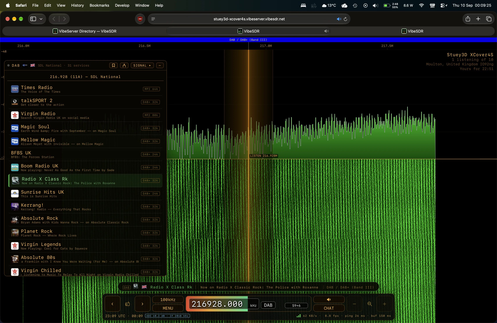 |
|:---:|
| *The web client on DAB block 11A, served from that phone: 31 services with logos and live programme text.* |

---

VibeSDR and its ecosystem were thought up, designed, tested, broken, tested some more and tinkered with
until they were just right by me, and coded by AI.

Almost everything has been tested by me, on my own hardware and on the air. What I can't test myself,
I've tested closely with members of the SDR community who can (see [Credits](#credits)).

The project is GPLv3 and fully open source, and everything is committed: mistakes, failed experiments,
dead ends and all. It's an open and honest project with nothing to hide.

Some features have been left out, and can't be included unless their patents expire or move to
FRAND (fair, reasonable and non-discriminatory) licensing. These include HD Radio and the digital
voice modes that use the AMBE codec. DAB could be included because it is an open standard published
by ETSI, and its codecs are either out of patent and built into VibeSDR (MP2), or decoded by the
host operating system's own decoder (HE-AAC), so no patented codec is in our code.

## Tested on

Not a spec sheet: the devices every feature has actually been driven on, on the air.

| | |
|---|---|
| **iPhone 17 Pro Max** | the easy one, where everything works |
| **iPhone SE (2nd gen)** | a 2020 A13 with a 4.7″ screen: the layout floor |
| **Moto G35 · Galaxy XCover 4s** | budget Android: the thermal and DSP floor |
| **Galaxy Tab A9 · iPad Air 13″ (M2)** | tablet layouts, landscape decoders |
| **M4 MacBook Air** | the Mac app, where it is written |
| **Apple Watch Ultra 3 · Series 6** | the wrist waterfall |
| **Raspberry Pi 500 · Raspberry Pi 2 · Intel Core i5 on Ubuntu 24.04** | VibeServer hosts, from fast to the 2015 floor |
| **Galaxy XCover 4s · Sony Bravia Android TV** | VibeServer on Android: the app's built-in server, and VibeServer Lite on a bedroom TV with Advanced RDS and DAB+ |
| **SDRplay RSP1A and RSP1B · RTL-SDR V4 and V4L · Airspy HF+** | the radios |

The ones that matter are the SE, the budget Androids and the Pi 2. Anyone can test where everything
already works.

## Building

```bash
npm install
cd ios && pod install && cd ..     # iOS only
npx expo run:ios                   # or: npx expo run:android
```

VibeServer builds with CMake from `vibeserver/` (Linux and macOS); see `vibeserver/linux/INSTALL.md`.
Design notes and specifications for individual features live in [`briefs/`](briefs/) and [`docs/`](docs/).

## Credits

The same list as the app's About page, audited against the source for V11. Each line says what
was **used** (bundled, linked or fetched) or **learned** (read as a reference, no code taken).

### People

| Name | Role |
|---|---|
| **Stuart Carr (Stuey3D)** | UI/UX design, concept & testing |
| **madpsy (M9PSY)** | Creator of UberSDR, and the reason this project exists. VibeServer speaks UberSDR's protocol; the RTTY/NAVTEX, WEFAX and SSTV decoders are C++ ports of his UberSDR decoders, and NR2 / noise blanker / WebSDR-NR are ports of his web client's; colour palettes, band plans, bookmark format, the HFDL/spots maps and the waterfall smoothing pipeline started from his work |
| **TGCFabian** | The biggest outside source of testing and ideas VibeSDR and VibeServer have had — HackRF support (on his hardware), the deviation monitor, the composite eye diagram, releasing the SDR when idle so other applications can use it, and working behind a reverse proxy all exist or work properly because of him; he also checked our MPX deviation against MPX Tool station by station. He ran VibeServer in a genuinely complicated environment and kept reporting what broke there, which is what made it robust rather than merely working on the bench it was written on |
| **Onfliner** | Airspy R2 / Mini: the first person to run that driver on real hardware — he reported the gain, bias-T, sample-rate and settings faults that stood between it and working, and asked for the Sensitive / Linear / Free gain modes it now has. The MPX tools: he found the deviation meter under-read quiet stations (an average published as a peak), then tested Advanced RDS against MPX Tool with a **test signal from his own transmitter** — a 22-point sweep, then known RDS deviations of 1.2, 3.0 and 5.1 kHz read through an Airspy Mini and an RTL-SDR. The RDS deviation calibration comes from that measurement, and his pilot and 75 kHz test-tone checks validated the rest of the MPX chain |
| **Hans van Eijsden (FMDX.org)** | Calibration and validation of the Advanced RDS analyser against a PIRA FM broadcast analyser — he found that our phase reading was its own reflection and that the deviation figures were scaled wrong, and kept testing until they agreed. Also the only route to testing Long PS, RadioText+ and PTYN; found the Dutch-locale 1005 MHz fault and three Mac VibeServer faults |
| **PU5WHB** | Showed how VibeSDR is actually used, and on what hardware, in Brazil — which set off the optimisation push to run on the lowest-end machines we could reach (a Raspberry Pi 2 was bought specifically to build VibeServer on because of it). He also put up the first public VibeServer outside Stuart's and TGCFabian's, which is how Brazilian RDS came to be understood: their stations rotate the station name as a marquee, and the learning RDS bookmarks never worked properly on his server until they were changed to cope with it. His server is also why radios have a settable display name and why Save View For All works in Safari |
| **xavxx** | An App Store user whose Discord report — an older app meeting a newer VibeServer with a blank spectrum and an endless "Connection lost", and a Jr squelch that did nothing — is why V11 is a compatibility programme |
| **Michael (DL8LDN)** | Tested against OpenWebRX and reported on GitHub (issue #22): the OWRX map with no way back, ignored digital-mode bookmarks, the decoder history, DRM dropouts; asked for the 5 kHz broadcast step and waterfall taps that snap to the step, and found the squelch marker not following the visual gain trim |
| **NickB (G4IRX)** | Ran VibeServer in the field, an Airspy HF+ and a phone serving his club from a beach over 4G. His overnight crash on a Pixel is how the Android Airspy HF+ fault was found and fixed, along with re-plug recovery, crash capture and log export for server owners. Helped design airband as an aviation radio: the 8.33 kHz step, channel names, pilot-style entry and spacing passbands. Bookmarks keep their passband, the shared-dial flicker was found on his server, recordings got their own button, and RTTY, NAVTEX and the spectrum each got a fix from his reports; asked for the C-QUAM AM stereo decoder |
| **@Sagistario306** | Reported the first-launch CONTINUE button being untappable on a small-screen ZTE Blade L8 |
| **Claude (Anthropic)** | AI coding and development assistant |

### Receivers, protocols and references (read, not copied, unless it says so)

| Name | Role |
|---|---|
| **John Seamons (ZL/KF6VO) — KiwiSDR** | Protocol reference for the KiwiSDR backend; its IMA-ADPCM flavour (from libcsdr, after Tim Kientzle) is ported exactly; VibeDSP's MMSE noise reduction is the same published method Kiwi ships (Ephraim & Malah; Kim & Ruwisch), and its auto-notch follows Kiwi's structure |
| **Jakob Ketterl (DD5JFK), Marat Fayzullin & the OpenWebRX+ project** | Protocol reference for the OpenWebRX backend; its ADPCM flavour is ported exactly; csdr (András Retzler, HA7ILM) is the reference for its squelch and S-meter behaviour |
| **NoobishSVK & contributors** | FM-DX Webserver + the servers.fmdx.org receiver map — protocol reference for the FM-DX backend and its 3LAS MP3 audio (GPL-3.0) |
| **Airspy — SpyServer** | The SpyServer protocol, implemented clean-room from network captures; no code, header or structure copied |
| **Phil Karn (KA9Q)** | [ka9q-radio](https://github.com/ka9q/ka9q-radio) — the SDR engine underneath UberSDR, and (GPL-3.0) the design reference for VibeSDR's front-end automatic gain: IF-power level targeting, proportional correction and snap-to-hardware-steps. Read and credited, never copied |
| **Adam (mrwish7)** | [sdrpp-mpx-analyzer](https://github.com/mrwish7/sdrpp-mpx-analyzer) — an independent check on Advanced RDS. We ran its MPX analysis, unmodified, on recordings of 21 stations from an RTL-SDR and on test signals of known phase: it agreed with ours on MPX power and pilot level to 0.03 dB and 0.04 kHz, and its RDS-to-pilot phase is what confirmed the sign the panel now shows (+ leads) and exposed a bias of a degree or more where programme audio pulled our pilot loop — fixed by giving the measurement a loop of its own. Run on the bench as a reference; none of its code is in VibeSDR. |
| **Oona Räisänen (windytan, OH2EIQ)** | [redsea](https://github.com/windytan/redsea) (MIT) — the reference for VibeDSP's weak-signal RDS block recovery: syndrome-table burst correction, rhythm-based sync acquisition and error-rate sync dropping. No redsea code is used; the ideas are hers. Also slowrx, whose SSTV timings reached us through UberSDR's port |
| **Konrad Kosmatka** | librdsparser (MIT) — reference for the RDS PI + ECC → country mapping (IEC 62106) behind the RDS country flags |
| **Albrecht Lohofener & contributors (welle.io)** | Read clause by clause while building and repairing VibeSDR's own DAB receiver — FIC/FIG parsing, MSC handling and the OFDM front end. No code used; it is the reference that made ours correct |
| **Stefan Pöschel (dablin)** | Reference for DAB/DAB+ superframe, PAD and audio handling, and how a decoder should behave when a subchannel goes away |
| **Jan van Katwijk (dab-cmdline)** | Reference for DAB demodulation and the automatic frequency/timing corrections a receiver applies |
| **FiendChain (DAB-Radio)** | Reference for the DAB physical layer, and the project whose notes pointed at the TII and DAB+ error-correction work we took further |
| **Edouard Griffiths (F4EXB) & contributors (SDRangel)** | Its DAB demodulator's bandwidth and sample-rate notes |
| **ETSI and IEC** | The DAB receiver is written from EN 300 401, TS 102 563, TS 103 466 and companions (tables extracted from them); RDS from IEC 62106 |
| **Pothosware & Franco Venturi (SoapySDRPlay3)** | The open, authoritative account of how each SDRplay RSP model behaves — per-model antenna ports, bandwidth-for-sample-rate, and the quirks the vendor headers omit. No code used |
| **Alexandre Rouma & contributors (SDR++ / SDR++ Brown)** | VibeSDR V4's on-device radio was built on the SDR++ Brown DSP core; V5 replaced it with VibeDSP, our own clean-room GPL-free engine, and all SDR++ Brown code was removed along with the FFTW, VOLK and Zstandard libraries it brought — none is bundled now. Some waterfall palettes originate here, VibeDSP's spectrum window matches its, and it is the reference for how the Airspy R2/Mini presents its gain: Sensitive / Linear / Free (GPL-3.0) |
| **NXP TEF668x, PIRA, MPX Tool** | Behaviour, not code: the TEF tuners are the model for iMS, the FM noise blanker and automatic bandwidth; PIRA's MPX oscillograms for the composite eye; MPX Tool is what our testers measured deviation against |
| **Joe Taylor (K1JT), Steve Franke (K9AN) & the WSJT team** | FT8 and FT4 are their modes; ft8_lib's LDPC tables come from WSJT-X |
| **Receiver directories** | instances.ubersdr.org, servers.fmdx.org, receiverbook.de, rx.linkfanel.net (KiwiSDR) and the Airspy SpyServer directory |

### Code that ships

| Name | Licence | Where |
|---|---|---|
| **librtlsdr / rtl_tcp** — Osmocom rtl-sdr 2.0.3, Steve Markgraf & contributors | GPL-2.0-or-later | Android Local Hardware, VibeServer (all hosts), Lite; patched to open an Android USB handle |
| **libusb** | LGPL-2.1-or-later | Android, Lite, VibeServer (static on macOS) |
| **libairspyhf** — Airspy | BSD-3-Clause | Airspy HF+ driver; patched for Android USB handles |
| **libairspy** — Airspy (Vernoux, Touil, Gilmour) | BSD-3-Clause + MIT (IQ converter, filters) | Airspy R2 / Mini driver, unmodified |
| **libhackrf** — Great Scott Gadgets | BSD-3-Clause (library source) | HackRF driver; patched to open from a USB fd |
| **SDRplay API** — SDRplay Ltd | proprietary | Headers only; the library is loaded at runtime if the user installed it, never bundled |
| **KissFFT** — Mark Borgerding | BSD-3-Clause | The FFT inside VibeDSP (and inside ft8_lib) |
| **PFFFT** — Julien Pommier, after FFTPACK (© 2004 UCAR) | FFTPACK licence (BSD-style) | The DAB receiver's OFDM FFT |
| **ft8_lib** — Kārlis Goba (YL3JG) | MIT | FT8 / FT4 decoding |
| **Opus** — Xiph.Org Foundation | BSD-3-Clause | The streaming codec: VibeServer encodes, the app, watch and web client decode |
| **[opus-decoder / wasm-audio-decoders](https://github.com/eshaz/wasm-audio-decoders)** — Ethan Halsall | MIT | libopus in WebAssembly — how VibeServer's web client decodes Opus on a plain `http://` LAN address |
| **cloudflared** — Cloudflare | Apache-2.0 | The tunnel that lets a VibeServer be reached without port forwarding |
| **MapLibre GL JS** — MapLibre contributors | BSD-3-Clause | The GPU map engine (app, web client, directory) |
| **PMTiles** — Protomaps | BSD-3-Clause | The single-file map format the maps are served from |
| **Leaflet** — Volodymyr Agafonkin; **Leaflet.Terminator** — Jörg Dietrich | BSD-2-Clause; MIT | The fallback map engine where there is no WebGL (loaded from unpkg in the app and web client, bundled on the directory), and the directory fallback's greyline |
| **pako** — Vitaly Puzrin & Andrei Tuputcyn | MIT (zlib port) | gzip decompression of server messages in the app |
| **Fonts** — Atkinson Hyperlegible (Braille Institute), Nixie One (Jovanny Lemonad), JetBrains Mono (JetBrains) | SIL OFL 1.1 | UI face, instrument face, map labels |
| **Expo, React Native, Hermes, Skia, Reanimated, Gesture Handler, WebView, OkHttp, AndroidX Media3, Fresco** | various (MIT / Apache-2.0) | App framework and native stack |

DAB MP2 audio, the DAB Reed-Solomon and Viterbi decoders, the WebSocket server, the mDNS
responder and all of VibeDSP are our own code. DAB+ (HE-AAC) audio is decoded by the host's own
decoder — Android's MediaCodec, Apple's AudioToolbox, or an installed ffmpeg — never by a codec
we ship.

### Data

| Source | Licence | Used for |
|---|---|---|
| **Natural Earth** | public domain | Coastlines, borders, rivers, roads, region names |
| **NOAA / NCEI ETOPO2v2c** | public domain | Shaded relief and bathymetry |
| **RESOLVE Ecoregions 2017** (Dinerstein et al.) | **CC BY 4.0** | Biome colouring |
| **HydroLAKES / HydroSHEDS** | **CC BY 4.0** | Lakes and reservoirs |
| **GeoNames** | **CC BY 4.0** | Towns and cities |
| **OurAirports** (David Megginson) | public domain | Airfields and runways |
| **NGA World Port Index** | public domain | Sea ports |
| **© OpenStreetMap contributors** | **ODbL** | Detailed coastline (built in, never fetched; the derived data is published with every release) and Nominatim geocoding of a server's location |
| **Ofcom** | **OGL v3** — contains public sector information licensed under the Open Government Licence v3.0 | UK DAB transmitter identification |
| **BAKOM** (Federal Office of Communications, Switzerland) | opendata.swiss **"Open use"** | Swiss DAB+ licensed sites ([survey](docs/DAB-SITES-SOURCES.md)) |
| **ČTÚ** (Czech Telecommunication Office) | data.gov.cz terms — no copyright or database right (CC0) | Czech DAB licensed sites |
| **RDI** (Rijksinspectie Digitale Infrastructuur, NL) | **CC0 1.0** | Dutch DAB licensed sites |
| **EiBi** | — | Shortwave schedules: live bookmarks and the directory's station finder |
| **[Signal Identification Wiki](https://www.sigidwiki.com/)** (sigidwiki.com, a public-benefit project funded by its own advertising) | linked, never copied — contributors' content stays theirs | "What is this signal?": every chat answer and the SIGNAL ID WIKI key open its pages, unmodified, with the site's own address and ads |
| **RadioDNS** and **radio-browser.info** | — / community | Station logos |
| **NOAA Space Weather Prediction Center** | public domain | Solar flux and K index for band conditions |
| **AFRINIC, APNIC, ARIN, LACNIC, RIPE NCC** delegation stats and **iptoasn.com** | free / PDDL | Listener country and network on the server's admin page |
| **GQRX, KiwiSDR, CuteSDR, SdrDx, OpenWebRX, matplotlib** | — | Waterfall palette origins |

## Questions people actually ask

**Why no WebSDR support?** WebSDR is closed-source and its author has not sanctioned third-party
clients. VibeSDR only implements platforms that welcome independent clients. Out of respect for
that, WebSDR support will not be added.

**How does DAB+ work without a licensed codec?** VibeServer runs its own DAB receiver, written from
the ETSI standards: the OFDM front end, the error correction and the MP2 audio of plain DAB are our
own code. DAB+ audio is HE-AAC, and that part is decoded by the decoder the host already has,
Android's MediaCodec, Apple's AudioToolbox or an installed ffmpeg, never by a codec we ship.
Receivers that can do it carry the DAB+ mark in the directory.

**Why no DRM, HD Radio or DMR?** Patents, not difficulty. HD Radio is Xperi's; DRM needs xHE-AAC
licensing; DMR, D-STAR, System Fusion and NXDN need the AMBE/IMBE vocoders (DVSI). Shipping
unlicensed implementations in store builds is a risk VibeSDR won't take. Where an OpenWebRX server
decodes those modes *server-side*, VibeSDR simply plays the PCM it sends; no codec ships in, or runs
inside, the app. Codec2-based FreeDV and M17 are unencumbered and remain candidates.

**Why do the skip buttons vanish on FM-DX?** An FM-DX Webserver is one physical tuner shared by
everyone connected, so tuning it retunes it for all of them. Lock-screen and in-car skip buttons
would let you change the station for people you can't see, so they're disabled out of courtesy.
On the watch, the Crown is disarmed until you deliberately arm it.

## Privacy

No personal data, no analytics, no ads, no tracking, and no data-collecting SDK of any kind.
Third-party code in these apps is limited to what makes a radio work: open-source drivers and
codecs, and the Cloudflare tunnel client that lets a server be reached from outside. None of it
reports to the developer or to anyone else. Location is optional, coarse, and used only to sort
receivers by distance.

That is a position, not an accident of being small. Companies approach hobby apps with paid
SDKs — analytics, advertising, and lately "bandwidth sharing" SDKs that quietly turn every phone
running the app into a proxy exit node that other people's traffic leaves through. VibeSDR has
been offered money for exactly that and has refused, and will keep refusing, whatever it pays.
Your phone is yours. Nothing in this app will ever use it, or you, as the product.

The same thinking is why VibeServer reaches the internet through a Cloudflare tunnel rather than
a forwarded port. A tunnel is slower and less efficient than a port-forwarded server, and it is
chosen anyway: nothing inbound ever touches the owner's home address, nothing is exposed to
scanners, and the address is never in any listing. It protects the owner from exposure; it is
not end-to-end encryption, since the tunnel terminates at Cloudflare's edge like any site behind
it. An owner who would rather take the speed and manage their own exposure can still run a
direct, port-forwarded server; the tunnel is the default, not the only way.

Because every released build's source is in this repository, none of this has to be taken on
trust: the dependency list is public, and anyone can capture the app's traffic and see exactly
which endpoints it talks to. See [`PRIVACY.md`](PRIVACY.md) for the full policy.

## Licence

**GNU General Public License v3.** Redistribute and modify it under those terms; it comes with no
warranty. Full text: <https://www.gnu.org/licenses/gpl-3.0.html>

Official App Store / Google Play builds carry an additional permission under GPLv3 §7 — see
[`APPSTORE-EXCEPTION.md`](APPSTORE-EXCEPTION.md). The complete source for every released build
stays here under the GPLv3.

UberSDR, OpenWebRX / OpenWebRX+, KiwiSDR and FM-DX Webserver are the property of their respective
creators and subject to their own licence terms.
