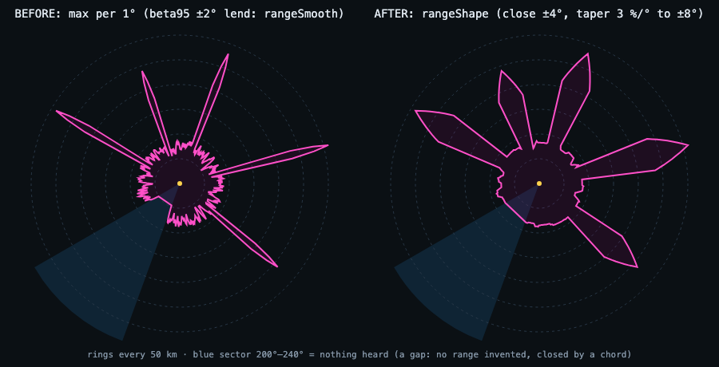

# TWO LIVE MAPS: AIR & SEA, and AMATEUR (V12, beta96)

Branch `b96-onemap` (from `v12-experimental` = beta95 c7fbde793), 2026-11-26.

Stuart (2026-11-26): *"b95 is out so do this as the main b96 change"*, which approved ONE LIVE MAP: ships, aircraft and
the other mapped modes together, as the community map already shows them.

Stuart, later on 11-26 (design change, via the coordinator): **TWO maps, not one.**

1. **AIR & SEA map** (shown as "AVIATION & MARITIME"). Holds ADS-B, ACARS, VDL2, HFDL (+ ADS-C), NDB, VOR, AIS, DSC,
   NAVTEX, sea areas and **radiosondes**. Sondes are aloft and are weather, so they sit with aviation. Lists in tabs:
   AIRCRAFT / SHIPS / MESSAGES (+ NAVTEX / SONDES where there is something to list).
2. **AMATEUR map** (the DIGI MODES MAP grown into the amateur and hobby map). Holds digital spots (FT8/FT4/WSPR/JS8 …), CW
   and RTTY skimmer spots, NCDXF beacons, APRS and **MeshCore / Meshtastic**. MeshCore is licence-free LoRa, but it is
   hobby and community traffic, so it goes here and not on the air/sea map. Lists in tabs: SPOTS / APRS / MESH (+ BEACONS).

**Why two.** The two maps serve different audiences and work at different scales:
- The air/sea map is about **traffic and safety**. It runs at a local-to-regional scale (NM rings, the ADS-B range,
  airports, ports, sea areas), and every layer comes from a decoder that hears vehicles and the services around them.
- The amateur map is about **propagation and people**. It runs at continental-to-world scale (great circles to
  spotters, grids, bands), and its layers are callsigns. One chip row holding 20 layers would be unreadable on a 4"
  phone (see feedback_control_deck_stays_minimal).
- **The COMMUNITY map is the combination** (Stuart confirmed the split 11-26: "exactly what I was thinking"). It holds all
  of AVIATION & MARITIME plus the MeshCore repeaters, as it does today, and never amateur spots. It lives on
  main/directory and is not part of this build. The shared kit pieces stay pure and exportable so the three maps keep
  one vocabulary: the layer catalogue (`LIVE_LAYERS`, `LIVE_GROUPS`), the glyphs and `fadeOf` (`web/community/kit.ts`
  can export them).
- The brief's MISC group is gone: sondes moved to air/sea, APRS and MeshCore to amateur.

Both maps are built on **one map kit and one shared code path**:
- `src/services/liveMaps.ts` (pure, no DOM, no React Native) holds the map catalogue, the live-layer rule, the title,
  exit and tab rules, the aircraft list, the message feed and the fade.
- The web's `TrackView` (`web/client/src/tracks.ts`) and the app's `MapOverlay` track page draw both maps.
- `web/mapkit` draws the shapes: `tracklayer.js` and `adsblayer.js`. Both are bundled into the app as strings by the
  `gen-*-source` scripts.

## THE RULES (both maps)

### 1. The current mode is the LIVE layer
`liveOf(mode)` maps the receiver's current mode to `{ map, layers[], tab }`:

| Current mode | Map | Live layer(s) | Opens on tab |
|---|---|---|---|
| ADS-B | air/sea | ADS-B | AIRCRAFT · NEAREST |
| DATALINK (ACARS / VDL2) | air/sea | ACARS + VDL2 (+ ADS-C) | MESSAGES · (aircraft sort LATEST) |
| HFDL (USB on an HFDL channel, decoder on) | air/sea | HFDL + HFDL STATIONS | MESSAGES |
| NDB | air/sea | NDB | NAVAIDS |
| VOR MAP | air/sea | VOR | NAVAIDS |
| AIS | air/sea | SHIPS | SHIPS |
| DSC box on | air/sea | DSC | SHIPS (DSC section) |
| NAVTEX box on | air/sea | NAVTEX (stations / warnings / weather) | NAVTEX |
| SONDES | air/sea | SONDES | SONDES |
| anything else | the map the menu key named | none live: every layer is stored | that key's tab |
| FT8/FT4/WSPR/JS8/…, CW / RTTY skimmer | amateur | SPOTS | SPOTS |
| APRS box on | amateur | APRS | APRS |
| ISM (LoRa) | amateur | MESH | MESH |
| NCDXF tracker on | amateur | BEACONS | BEACONS |

- **The live layer updates in real time and is emphasised.** It always has a chip, and that chip comes first and is
  marked LIVE. Its markers are drawn at full strength and its list section sits first.
- **Every other layer shows what this server has STORED.** Sources: the shared aircraft table (`aircraft.json`), the
  ship store (`ais-ships.json`), the gallery (DSC, NAVTEX, NDB/VOR cards, sondes), the station store (`stations.json`)
  and the remembered mesh nodes. These markers are **faded by age** (`fadeOf`) and are never drawn as live.
- **A mode change while the map is open only changes which layer is live.** The title, the exit key and the list
  follow the current mode on the very next render, because they are all computed from `(map, liveOf(mode), openedAs)`.
  Nothing is cached when the map is made. This makes Mac Ha's bug (11-26: the AIS map kept "SHIPPING MAP" after an
  exit to ADS-B) impossible here: **one view per map, and its chrome is recomputed on every render**. The old
  arrangement had one view per mode, each titled when it was made.
- **Exit:** while the map is the mode's own screen (ADS-B, AIS, DATALINK, NDB, VOR MAP, SONDES), the key reads
  `EXIT <MODE>` and leaves the mode, giving the receiver back as before. Opened from a menu or a box, it reads
  `CLOSE MAP` and the mode carries on. THE ONLY MODE: CLOSE MAP, with the note.

### 2. Layer chips, grouped
- AIR & SEA: **AVIATION** (ADS-B · ACARS · VDL2 · HFDL · ADS-C · HFDL STATIONS · NDB · VOR · AIRPORTS) ·
  **WEATHER ALOFT** (SONDES) · **MARITIME** (SHIPS · DSC · NAVTEX STATIONS · WARNINGS · WEATHER · SEA AREAS).
- AMATEUR: **SPOTS** (by family: DIGITAL · CW · RTTY) · **APRS** · **MESH** · **BEACONS**.
- **A layer with nothing on this server is ABSENT** (AGENTS.md: no dead controls). One layer alone draws no chip row.
  The live layer is always present. Presence is computed from what the server returned, never from a hard-coded list
  (feedback_app_no_hardcoded_settings). A group with one present layer shows the chip with no group label.
- Toggles are remembered per map (`vibesdr.airSeaLayers`, `vibesdr.amateurLayers`; the app uses AsyncStorage with the
  same keys). The old per-map keys (`vibesdr.avMapLayers`, `vibesdr.shipMapLayers`, `vibesdr.navMapLayers`) are read
  once as the starting values.

### 3. Lists as TABS under the map
- **AIRCRAFT**: every source in one row per aircraft (the shared table's merge: ICAO address, then registration, then
  flight), with source badges (ADS-B · VDL2 · ACARS · HFDL · ADS-C). **Emergency (7500/7600/7700, declared) and military
  are pinned to the top.** A sort chip offers **NEAREST | LATEST**. In ADS-B the live report's rows win.
- **SHIPS**: the current ship list unchanged, including the beta95 DX tag and "position implausible", plus the DSC
  section.
- **MESSAGES**: the datalink feed, newest first. Sources: this radio's live DATALINK messages, plus the shared table's
  last label per aircraft from the other radios. Tap a message and its aircraft is highlighted (`focus`). Tap an
  aircraft (row or map) and the messages are filtered to it, with a chip "× REG / FLIGHT" to clear the filter. ⚖ The
  message text appears only where it does today: on the owner's own session, with the opt-in. Everyone else sees the
  label's plain name (`labelName`), as the shared table holds.
- **NAVTEX** (when NAVTEX layers are present): stations, warnings and weather, as the current RECEIVED list's sections.
- **NAVAIDS** (NDB / VOR): the NDB and VOR lists as their maps have them.
- **SONDES**: the sonde list.
- AMATEUR: **SPOTS** · **APRS** · **MESH** · **BEACONS**.
- **A tab with nothing is ABSENT**, the same rule as the chips. The tab you came from is chosen when the map opens. A
  mode change moves to the new live layer's tab, unless the viewer has picked a tab since the map opened, in which case
  their choice stays.
- **Rows are capped** at 300 per tab (the shipping map's existing cap) and the list renders only the tab shown. This is
  the 32-bit 1 GB Android rule (android_potato_phone_users).

### 4. Data and cost
- Polls are floored and run only while the map is open (the Workers incident):
  - `aircraft.json` every 3 s, as today.
  - The ship store, NAVTEX and DSC every 30 s, as today (2 s while NAVTEX is still building its index).
  - `stations.json` on the digi map's existing schedule.
  - Nothing while the page or app is hidden.
- The live layer needs no new request: ADS-B, AIS, DATALINK, NDB, VOR and SONDES already push reports over the socket.
- Memory stays bounded. Each source is already capped (aircraft table 1024 rows, ship store `limit=1000`, warnings
  300). The maps add no new caches, and one view per map replaces up to four TrackViews (navView, aisView, avView,
  avMapView). That saves a MapLibre context each time the user moves between them.
- **No request goes through the Worker.** Everything is this server's own HTTP (feedback_worker_only_establishes).

### 5. The basemap
- AIR & SEA uses a new profile pair, **`airsea`** (airports and ports, major places) and **`airsea-plain`** (AIRPORTS
  off), added to `vibemap-style.json`. A server whose map pack predates the pair falls back to `aero` / `aero-plain`
  plus the `ports` layer switched on by name, the way an older pack's airports are already switched by name.
- AMATEUR keeps the `spots` profile.
- NM scale bar on air/sea, km on amateur. The greyline on both. High Detail Maps packs are used by both, unchanged
  (`mapgl.ts probeMapGL` / app `mapglDetail`).

### 5b. The click order (coordinator 11-26, after Stuart's community-map bug, fixed there in main 55a69c998)
On the community map, an aircraft drawn over a NAVTEX area opened the AREA's card: each layer had its own click
handler, and the area's ran last and replaced the aircraft's. Both live maps press in ONE order: **receiver → points
(aircraft, ships, stations, spots) → lines / tracks → areas** (sea areas, NAVTEX area warnings, forecast arrows, the range
outline), and an area answers only when nothing else is under the finger.
- Our maps have one place where this matters. The track layer's markers are DOM elements (they take the press first),
  while the aircraft are GPU symbols on the ADS-B layer. Areas' shapes are not clickable at all
  (`interactive:false`); only their MARKERS are: a sea area's name, an area warning's icon, a forecast arrow.
- `tracklayer.js opts.yieldClick(item, ev)`: an area-class item (`isAreaItem`: `_nofit`, cluster `'m'`, or a shape of
  kind `'area'`) first asks the host. The host asks the ADS-B layer: `adsblayer.js pickAt(clientX, clientY, touch)`,
  which takes 12 px of slack, or 20 on touch. If an aircraft is there, it is selected and the area's card is not opened.
  The same rule runs on the web (`TrackView`) and in the app (the `'airsea'` page's trkMake).
- Hover: DOM markers show the pointer and aircraft show the canvas pointer (adsblayer `onGlHover`). Both say "this is
  pressable", so the order shows only when a press is made.
- Test: `test-web-avmap` drops an aircraft onto a sea area's marker and presses it, expecting the aircraft's card and no
  area card.

### 5c. The ADS-B RANGE outline's shape (Stuart 11-26: "still a STAR" on the Sony and Almere)
`adsblayer.js rangeShape` replaced beta95's ±2° lend (`rangeSmooth`, kept for reference). One rule for the live-grown and
the stored outline (`rangeGeo`); the server's store (vibe_adsb_range.h) is unchanged. Named constants:
`RANGE_GAP_DEG` 10, `RANGE_CLOSE_DEG` 4, `RANGE_TAPER` 0.03, `RANGE_SPREAD_DEG` 8.
1. **Gaps stay empty**: a run of ≥ 10° with nothing heard invents no range; the outline closes across it with a chord
   from the last heard bearing on each side (never a spoke to the receiver).
2. **Dips filled**: a morphological CLOSE (dilate then erode, ±4°, wrapping, gaps ignored).
3. **Needles softened**: each bearing lends its neighbours its range less 3 % of it per degree, out to ±8°; the max wins.
Nothing is ever lowered, so every true furthest point stays on the outline (the FURTHEST chip's aircraft is a vertex).
Tests: test_adsb_layer (a starry synthetic set: worst vertex ≤ 1.25 × both 4°-away neighbours, raw > 2; the 40° gap
draws nothing; dips closed; no spoke; a lone far bearing is a −3 %/° bump), test-web-adsb-range 37/0.
Before / after (rendered from the layer's own functions, `docs/v12/img/adsb-range-shape.svg`):

Note: with only ±8° of spread, an aircraft 3–4× the core's range still makes a petal (a broad bump with a step back to
the core at ±9°) — honest, but a FLOWER rather than a star. A longer spread (until the taper meets the core) would make
triangles instead; that invents range ±25° around one aircraft, so it is Stuart's call (Decisions).

### 6. Menus: nobody loses their way
Each existing entry opens the right map, layer and tab:

| Entry (web and app) | Opens |
|---|---|
| ADS-B mode | AIR & SEA, ADS-B live, AIRCRAFT · NEAREST, `EXIT ADS-B` |
| ADS-B's AVIATION MAP key | (gone: the ADS-B map IS the air/sea map; other sources show as stored layers) |
| DATALINK mode / box MAP | AIR & SEA, ACARS+VDL2 live, MESSAGES |
| HFDL box MAP | AIR & SEA, HFDL, MESSAGES (CLOSE MAP) |
| VIEWS · AVIATION | AIR & SEA, AIRCRAFT (CLOSE MAP) |
| AIS mode | AIR & SEA, SHIPS live, SHIPS, `EXIT AIS` |
| VIEWS · SHIPPING, NAVTEX box MAP, DSC call MAP, gallery AIS / NAVTEX / DSC rows | AIR & SEA, that layer, SHIPS / NAVTEX (CLOSE MAP), on the item when given |
| NDB / VOR MAP modes | AIR & SEA, that layer live, NAVAIDS, `EXIT NDB` / `EXIT VOR MAP` |
| SONDES mode / box MAP | AIR & SEA, SONDES live, SONDES |
| VIEWS · DIGI MODES, spots MAP, gallery spot rows | AMATEUR, SPOTS |
| APRS box MAP | AMATEUR, APRS |
| ISM box MAP (mesh) | AMATEUR, MESH |
| NCDXF box | AMATEUR, BEACONS |

The VIEWS keys are renamed AIR & SEA and AMATEUR. Each key is drawn only where its map has something to show, the
existing `viewsProbe` rule.

## FEATURE CHECKLIST: nothing lost

✓ = on the new map and tested · ◐ = on the new map, not yet tested · ☐ = not yet carried over · ✗ = dropped (with reason)

### ADS-B aircraft map — WEB DONE (stage 4: `#adsbView` and `AdsbMap` retired); APP DONE (stage 6: MapOverlay kind 'adsb' retired)
On the web ADS-B mode IS the AIR & SEA map's ADS-B-live state (`adsbUiOn` → `asOpen({ by: 'mode', tab: 'aircraft' })`).
Its own chrome waits hidden in `#adsbChrome` and `adsbChromeMount` moves it into the map's TrackView slots while ADS-B is
live (`slot('top' | 'head' | 'over')`); `adsbChromePark` puts it back. The app's ADS-B mode keeps its own map until stage 6.
- ✓ The map is the mode; EXIT ADS-B leaves it (`asExit` → `adsbSetMode(false)`); Back with nothing open leaves it; the only
  mode draws no EXIT and the note (`onlyModeExits` 'adsb' → the map's exit key) — test-web-avmap ADS-B section, test-web-only-mode
- ✓ Range outline (`prefs.range` / `rangeAll`) on the AIR & SEA map, labelled ADS-B RANGE, shaped by `rangeShape` (§5c)
- ✓ Rings in NM, AUTO / FIT / RINGS, glide, dead reckoning, new-aircraft rings: the ADS-B layer on the AIR & SEA map (test-web-avmap: the controls `AUTO,FIT,RINGS,RANGE,LABELS,⌖`)
- ✓ Airports + runways (`aero` / `airsea` profile), greyline, NM scale (test-web-avmap, test-web-shipping-map)
- ✓ Silhouettes, operator logos (imageBase), flags, MIL, the card with its ODC-By credit (test-web-avmap beta91 rows)
- ✓ (web) ADS-B's own live list in the AIRCRAFT tab (`adsbListHtml(…, 'adsb:')`: altitude + climb, speed, range, bars,
  tracked NM, emergencies then military then nearest; each row a `.trkRow` keyed as its map item), the other sources'
  aircraft after it with their badges; NEWEST / FURTHEST / LONGEST TRACKED under the list's header (AIRCRAFT only);
  GAIN (+ its pop-over), the capture warning and CHAT in the top bar; the antenna (feed) warning over the map. No sort
  chip while ADS-B is live (the list keeps its own order). The live report's raw rows are the map's `_adsb` items, so the
  card has the squawk and the emergency, and they win over the shared table's row for the same aircraft
- ✓ (web) a row pressed opens its card and stays lit across the once-a-second redraws (TrackView remembers the press
  and re-finds the row, keeps the pad highlight and keyboard focus); CHAT's panel stays reachable over the map (`liveIds`)
- ✓ (web) the top bar on a phone: EXIT anchored, everything else ONE row scrolling sideways (`.scr`), the status line
  under it — every track map, as ADS-B's own bar did (Stuart 2026-10-25)
- ✗ the ⓘ legend button: the map's KEY lists the aircraft tones (avLegendHtml) — one key, not two
- ✗ the health pill's place under the bar (`body.adsbMap`): the AIR & SEA map covers it as every track map does
- ✓ (app, stage 6) ADS-B mode's screen is the 'airsea' page (`shownMapOf` adsbView → 'airsea'; `airSeaMode` 'adsb' while
  `adsbLiveHere`). The report's raw rows are `adsb:<hex>` items with `_adsb` (the ADS-B layer draws them: card with squawk /
  emergency, trails and logos from the radio) and win over the shared table's row for the same aircraft. EXIT ADS-B
  (`closeAirSea` → `exitAdsb`), the only mode → CLOSE MAP + note. The capture warning (top bar) and CHECK THE ANTENNA
  (`#capwarn` / `#feedwarn`, `__adsbCapture` / `__adsbFeedWarn`) on the 'airsea' page. The AIRCRAFT tab's body while ADS-B
  is live is ADS-B's own list (`AdsbLiveList.tsx useAdsbBody` inside TrackLiveList `adsb`): the GAIN key and card, NEWEST /
  FURTHEST / LONGEST TRACKED, emergencies then military then nearest, bars, operator logos, the ODC-By credit; the other
  sources' aircraft after it; no sort chip. The ADS-B layer's toggles (AUTO · FIT · RINGS · RANGE · LABELS) remembered as
  before (`adsbPrefs` → `lsv_adsb_map_prefs`); the list is the layer's obstacle (aircraft kept out from under it). The ⓘ
  legend key on the list is gone (the map's KEY, as the web). CHAT: the app's ADS-B map never had one; the app's chat is
  where it was. Tests: test_map_page_kind 72/0 (section 4: AIS ↔ ADS-B on the ONE page — re-titled, same WebView, no stale
  page; Mac Ha's exit-then-pick path; the only mode), tsc clean. ◐ not run on a device.
- ✓ ADS-B only while heard (`avNowRule`, the in-use words): test-web-avmap beta88 checks, on the AIR & SEA map
- ✓ (web) Emergency pinned top of AIRCRAFT while ADS-B is live (ADS-B's own list order, from the live report's squawk /
  emergency). From the shared table alone (no squawk there) only MILITARY is pinned (`info.mil`)

### Aviation map (web avView/avMapView, app 'avdata') — NOW THE AIR & SEA MAP
- ✓ Sources ADS-B · ACARS · VDL2 · HFDL · ADS-C as chips, absent when empty, the live / opened source first (test-web-avmap: `VDL2,ACARS,ADS-C,ADS-B,AIRPORTS`, HFDL box: `HFDL,HFDL STATIONS,…`)
- ✓ HFDL STATIONS, AIRPORTS → the profile, live (`aero` ↔ `aero-plain`, and `airsea` / `airsea-plain` with a maritime layer)
- ✓ Source-coloured glyph, multi-source number, faded past 10 min (avCompose, unchanged)
- ✓ The card: Heard on ADS-B + VDL2 … (test-web-avmap)
- ✓ DATALINK band control in the top bar while the DATALINK is on (test-web-avdata 23/0)
- ✗ THIS RADIO — HEARD NOW / OTHER SOURCES sections → replaced by the MESSAGES tab (this radio's messages as they
  arrive) and the source badges on each AIRCRAFT row ("VDL2 + ADS-B"). The owner's message text appears in MESSAGES
- ✓ The ODC-By credit line at the AIRCRAFT list's foot (test-web-avmap)
- ✓ Camera: the ADS-B layer's AUTO / FIT while aviation is live; the shared auto fit while a maritime layer is live (`setCamera`)

### Shipping map (web navView/aisView, app 'ais' / 'navtex' / 'dsc') — NOW THE AIR & SEA MAP
- ✓ SHIPS live (the AIS report, EXIT AIS) + the store (faded > 1 h), stored track; a live ship's trail from the server (test-web-ais-aprs 30+, test-web-shipping-map)
- ◐ beta95 DX tag / implausible position: the same rows (aisRows / shipRows unchanged)
- ◐ AIS safety strip (types 12/14): passed to the view as before
- ✓ DSC pins (DISTRESS SOS), opened on the call with DSC first (test-web-shipping-map)
- ✓ NAVTEX STATIONS (arcs), WARNINGS, WEATHER arrows, cards + TRANSLATE (test-web-navtex-map)
- ✓ SEA AREAS + tints (test-web-shipping-map, test_sea_areas). New: offered everywhere, OFF by default while nothing maritime is here
- ✓ Time filter on the maritime layers (the segmented control; the DATALINK's bands take its place while that mode is on)
- ✓ "Building the map…" note (test-web-navtex-map)
- ✓ KEY: aircraft tones + ships, DSC, hazards, marks, arrows, sea areas + sources (test-web-shipping-map, test-web-avmap)
- ✓ Ports AND airports on one basemap: the new `airsea` profile (old packs: aero + `ports` by name)
- ✓ Focus on the item it was opened for (DSC call, gallery row)

### NDB / VOR maps
- ✓ NDB (stage 8, web + app): NDB is a live state of the AIR & SEA map; `#ndbView` / the app's 'ndb' page are retired.
  - web: `ndb.ts NdbView.mount(asView)` moves NDB's pieces into the map's slots — RINGS · UNHEARD in the top bar, the tiles,
    HEARD LOG · FIND NDB · STATS and the beacon list (`#ndbList`, the readings streaming per row) under the NAVAIDS tab's
    header (`setTab`: hidden on the other tabs), the card over the map — and `park()` puts them back in `#ndbView` (never
    shown now). `NdbMap.openOn` makes `ndblayer.js` on the map's OWN map (`TrackView.whenMap`, gone with it); its new host
    options: `autoFit:false` (the map's FIT frames the beacons through `TrackView.morePoints`), `drawReceiver:false` (the
    track layer's house), `yieldClick` (an aircraft under the press wins — §5b). The NDB chip hides the beacons (the list
    stays — it is the mode's). KEY: `NDB_LEGEND`. EXIT NDB → `asExit` → `ndbSetMode(false)`. test-web-ndb 32/0.
  - app: `shownMapOf` ndbView → 'airsea'; `airSeaMode` 'ndb' (EXIT NDB, NAVAIDS, the chip `ndbChip`, status `ndbStatText`);
    the 'airsea' page loads NDB_LAYER_JS, `__ndbPush` makes the layer (autoFit:false, drawReceiver:false, `acLayer.pickAt`
    first), `__ndbOff` when NDB ends; the page auto fit's points include `ndbLayer.points()`. `NdbLiveList` → `useNdbBody`,
    the NAVAIDS tab's body inside TrackLiveList (`ndb` prop): tiles, RINGS · UNHEARD · HEARD LOG · FIND NDB · STATS, rows,
    the card, the dialogs (an open dialog takes the pad). The RN FIT chip is gone (the page's FIT). test_ndb_app 204/0,
    test_map_page_kind 72/0, test_map_autofit 64/0. ◐ not run on a device.
  - Fixed on the way: the app 'airsea' page's ⓘ legend was the SPOTS map's (BAND COLOUR). It is now aviation + maritime,
    with NDB / VOR / SONDES sections shown only while that layer is live (`.lgLive`, `legShow`) — the app KEY's VOR row.
- ◐ VOR (stage 8): radials, FIX crosshair + words (heading the NAVAIDS list), NAVAIDS tab, KEY (VORMAP_LEGEND), EXIT VOR MAP
  — web asRender (`vor:` keys) and app airSeaTrk; test_vormap_app 52/0 (wiring). No browser test of the VOR map exists
  (test-server-vormap is the server's). The app's KEY on the 'airsea' page has its VOR rows (live sections).
- ✓ (maps2) STORED VOR stations when the VOR map is not running — the gallery's `vor-<date>` day cards (see Radiosondes
  below, the same machinery): the last 7 days, at their published sites, faded by age, `vos:` keys, NAVAIDS tab rows
  ("remembered"), the KEY's remembered row, the status. Server feed `heardStations` tested (test-vormap 70/0); the client
  half by test_stored_layers. ◐ No browser run of the VOR half (no VOR browser suite and no VOR clip); the code path is the
  sondes' one, which test-web-sondes drives end to end.

### Radiosondes
- ✓ (stage 8) Sondes at last position, a chosen sonde's track (from the report), band control, EXIT SONDES, on the AIR & SEA
  map under WEATHER ALOFT — web test-web-sondes 22/0; app airSeaTrk (`sd:` keys), test_sondes_app ok. ◐ app not run on a device.
- ✓ (maps2) STORED sondes when SONDES is not the mode. There was NO gallery record of sondes or VOR stations (only the
  community map's `.community` rows, written only while the owner shares the map), so the server now writes one:
  `vibe_posgal.h` DayCard — `sondes-<date>` (gallery kind `sondes`) and `vor-<date>` (kind `vormap`), the ISM nodes card's
  rules (RAM, rewritten in place ≤ every 5 min and only when changed, once more when the mode stops / at midnight / a clean
  stop, adopted and read back after a restart, ≤ 300 rows, the oldest counted "Not listed"), a readable 10-field table
  (last · first · id · name · type · position · altitude · highest · MHz · country). Fed by `local_sdr_shim posGalTick`
  every 20 s while SONDES / the VOR map runs (`heardSondes` / `heardStations`), under the owner's gallery rules (gallery on,
  listeners' decodes kept). Clients: `src/services/storedLayers.ts` (ONE reader, web + app — `galPosParse`, the
  ismNodesParse pattern): sondes 24 h (≤ 2 cards), VOR 7 days (≤ 8 cards), merged (newest position, earliest first heard,
  highest kept), one card at a time, past days kept, ≤ 300; items faded by `fadeOf`, never ranked live (`sds:` keys);
  SONDES tab rows "remembered"; status; KEY rows. Polled when the map opens and every 2 min (web: only while visible).
  The gallery's filters gain SONDES and VOR (web + app). Tests: test-posgal 26/0, test-rs41-service 45/0, test_stored_layers
  37/0, test-web-sondes 33/0 (SONDES runs → stops → the card is in the gallery → VIEWS · AVIATION shows the three
  remembered, their card, the status).

### AMATEUR (the DIGI MODES MAP grown; web popup window `spotsMapHtml`, app MapOverlay 'digi')
★★★ Stuart 11-26 (via the coordinator): the AMATEUR map shows ANY spot in the window its filter picks (HEARD IN / age keys)
— background decoding's AND every listener's decoders' (FT8/FT4/WSPR/JS8, CW/RTTY skimmer, PSK, NCDXF, APRS, MeshCore) — not
only what the current mode decodes; the live layer is only emphasised. The station store already holds both
(`vibe_station_store.h` origin kBackground / kLive, `src` in stations.json); test-station-store now proves it: one background
FT8 spot and one listener CW skimmer spot both in 1 h, both gone two hours later, both in 24 h (150/0). The map's other
sources (APRS box stations, mesh nodes, NCDXF) must follow the same window when they become layers.
Stage 7 (`src/utils/amateurMap.ts` — one rule for the web window, the app page and the tests: `amKeep` / `AMATEUR_JS`):
- ✓ SPOTS from the station store (1H/24H/7D/30D/ALL) + live, coloured by mode, MODE filter + legend — unchanged; a stored
  station now also leaves at once when it ages out of a sliding window (web `mergeSpots` → `amKeep`)
- ✓ Stats panel (range / countries / bands / modes), TOTALS incl. the APRS line (now the window's APRS), radio filter, FIT/AUTO
  — unchanged (DIGI_STATS_JS); FIT frames MESH and BEACONS too
- ✓ ★ Stuart's window rule: APRS, MESH and BEACONS follow the SAME HEARD IN window as the spots, whoever heard them (web
  `aprsIn` / `meshIn` / `beaconsIn`; app `amWin()` from the age keys). Tests: test_amateur_map 146/0 (the rule, the page text =
  TS, a background src-1 and a listener src-2 spot in 1 H / gone 2 h later / back in 24 H, the same for APRS, MESH, BEACONS);
  test-web-ais-aprs 38/0 drives it in the real window (two stored stations, src 1 and 2, and the APRS stations).
- ✓ The LIVE layer (`amLiveOf`: the spots box / CW / PSK / RTTY → SPOTS, APRS box → APRS, ISM mode → MESH, NCDXF → BEACONS):
  its key first with a red dot (web `#layers .live`; app "● " on its key). Only emphasised — every layer stays shown.
- ✓ MESH layer (web + app): ISM's live report + the remembered nodes, `amMeshPoints`. ★ maps2 (Stuart's 11-26 decision):
  remembered nodes of EVERY ISM band over the map's window (`amMeshLoader` — every band's `ismnodes-` day cards, ≤ 16 cards,
  one at a time, past days kept, ≤ 1000 nodes; read on open, on a window change, every 2 min). test_amateur_map, and
  test-web-ais-aprs drives it in the real window (433 + 868 cards, ISM never ran → both bands' nodes in MESH).
- ✓ NCDXF BEACONS layer (web + app): the tracker's report, beacons heard on any band at their sites, a line from the receiver
- ✓ (web) Tabs SPOTS / APRS / MESH / BEACONS — the list in the window's corner (`#amList`, `amList()`), rows capped 300, each
  spot row saying who heard it (the store's `src`: background decoding / a listener's decoder); a row centres its station
- ✓ (app, maps2) the tabs: TrackLiveList over the 'digi' page (React Native — the pad walks it), SPOTS / APRS / MESH / BEACONS
  with counts, the live one marked ●; rows = `amListRows` (the web's rows: a spot says who heard it — the store's `src`, now
  carried on SpotRow; one only this app heard says "this app's decoder"), through the HEARD IN window (the window keys),
  ≤ 300 a tab, ages refreshed every 30 s; the tab rule `amTabNow` (pick → live → opened on → first). A row centres its
  station and opens its card (`__amFocus`; AMATEUR_JS keeps each MESH / BEACONS marker in `AM_MK`). ONE pad order with the
  window keys (MapOverlay `amNav`, shared into DigiMapKeys and TrackLiveList — two nav owners would strand the keys). Layout:
  bottom-left like every map's list; the summary strip, toast and scale stand clear (`__amListWH`, `body.amL`); hidden while
  the narrow STATS sheet covers the bottom half. test_amateur_map 187/0, test_nav_coverage (the shared order). ◐ not run on
  a device.
- ☐ Satellite pass overlay (digiOverlay) — unchanged, still drawn (not re-tested this stage)
- ✓ Titles: AMATEUR MAP (web window and app page, `storeWindows`); VIEWS' key reads AMATEUR (web `#mapBtn`, app mapLabel)
- ◐ The web map stays a WINDOW (not moved into the page as a TrackView) — see Decisions

## STAGING (the order of the build, each stage committed and mergeable)

1. `src/services/liveMaps.ts` + `scripts/test_live_maps.ts`: the catalogue, `liveOf`, chrome, tabs, the aircraft list
   (pinning, NEAREST/LATEST), the message feed and filter, the fade.
2. Web `TrackView`: dynamic chrome (`setChrome({title, exitLabel, listTitle})`), **tabs**, grouped chips with a LIVE
   mark, a sort chip.
3. Web AIR & SEA: one view (`airSeaView`) replacing navView + aisView + avView + avMapView. Shipping + aviation +
   sondes compose into it, AIS and DATALINK modes are its live states, and every opener is routed to it.
4. Web ADS-B mode as the AIR & SEA map's ADS-B-live state. The ADS-B chrome (GAIN, chips, capture, CHAT, legend) moves
   into the view's top-bar slot. `#adsbView` is retired.
5. App: MapOverlay kind `'airsea'` (the 'avdata' page: ADS-B layer + track layer) with title, exit and tab pushed live;
   TrackLiveList tabs; SDRScreen's `shownMap` collapses ais / navtex / dsc / avdata (and adsb at stage 6) onto it.
6. App ADS-B on the air/sea page (AdsbLiveList's features inside the AIRCRAFT tab, the GAIN key).
7. AMATEUR: the digi map gains MESH, BEACONS and tabs. On the web it moves into the page (one TrackView-hosted map)
   or stays a window; see the decisions.
8. NDB / VOR / SONDES as air/sea live states.
9. Copy: sdrTour, pickerTour, AboutOverlay beta96 note + feature lists, web tutorial, watch tutorials (if they mention
   the maps), website. vibe_web_page.h rebuilt via the lock.

## RESUME HERE

**State 2026-11-26 evening (branch `b96-maps2`, b96-integrate merged in at 76331e652, not pushed).** Everything in the beta96
maps brief is built: the app's AMATEUR tabs, stored sondes / VOR stations from the gallery (server card + clients), MESH from
every ISM band, the dead #ndbTop / #ndbLive CSS gone. Nothing has been run on a device.

| Stage | State | Where |
|---|---|---|
| 1 rules | ✓ `test_live_maps` 63/0 | `src/services/liveMaps.ts` |
| 2 TrackView | ✓ | `web/client/src/tracks.ts` |
| 3/4 web AIR & SEA (+ ADS-B) | ✓ test-web-avmap 84/0 | `main.ts` `asOpen` / `asRender` / `asExit` |
| 5/6 app AIR & SEA (+ ADS-B) | ✓ built, **not run on a device** | `MapOverlay.tsx` 'airsea', `SDRScreen` `airSeaTrk` |
| 8 SONDES · VOR · NDB | ✓ web + app; ✓ maps2 STORED sondes / VOR when the mode is off | `vibe_posgal.h`, `storedLayers.ts` |
| 7 AMATEUR | ✓ web; ✓ app (maps2: tabs, every-band MESH) | `amateurMap.ts`, `main.ts spotsMapHtml`, `MapOverlay` 'digi' |
| copy | ✓ About (both beta96 notes), web tutorial, the app's MODE tour card | |

**Next, in order:**
1. A device run of the app: the AMATEUR list (tabs with a pad, a row → its station, the narrow STATS sheet, the summary strip
   above the list, the wide layout right of STATS); the 'airsea' page (NDB, AIS ↔ ADS-B, SONDES / VOR MAP live and then
   remembered, DATALINK, NAVTEX, the ⓘ legend). 4" phone, Duo.
2. A real VOR capture through the VOR map so its gallery card is seen once (the coordinator — no VOR clip exists here).
3. iOS: the shim changed (posGalTick) — the iOS DSP lib needs `build_ios.sh` before an iOS build carries the cards
   (local hardware servers only; the clients' half is JS).
4. Optional: VIEWS · AVIATION on a server with ONLY remembered sondes / VOR (no aircraft or ship source) is not drawn
   (`syncViewKeys` does not look at the gallery) — rare (any radio that can run SONDES has ADS-B), left as is.

**Tested how (this Mac; a server built from this worktree via the build lock; headless Edge `--mute-audio`; synthetic clips
only — test-rs41 / test-ais / test-aprs / test-vdl2 / test-adsb `--write-clip`; nothing on air):** test-posgal 26/0,
test-rs41-service 45/0, test-vormap 70/0, test_stored_layers 37/0, test_amateur_map 187/0, test_nav_coverage ok,
test-web-sondes 33/0, test-web-ais-aprs 40/0, test-web-avmap 84/0, test-web-shipping-map 42/1 (the 1 = Humber's arrow,
pre-existing — the same on b96-integrate), test_ais_aprs_app 181/0, test_map_page_kind 72/0, test_live_maps 63/0,
test_map_autofit 64/0, test_ndb_app 204/0, test_ism_app 256/0, test_sondes_app ok, test_vormap_app 52/0 (a stale regex fixed:
NDB shares the Back line). `tsc` (4 GB): only the 45 existing errors under scripts/ and handheld-ui/test.

## Decisions for Stuart
- The datalink list's THIS RADIO / OTHER SOURCES sections were replaced by the MESSAGES tab and source badges. Keep it that way?
- SEA AREAS is on every air/sea map but OFF by default where nothing maritime is here. OK?
- A live layer's chip can be switched off like any other (it keeps its red dot). OK, or should the live layer be locked on?
- Opened from a gallery row, a layer is put first but not called LIVE, because no decoder is running. OK?
- VIEWS keeps both AVIATION and SHIPPING (each opens the one map on its tab). Merge them into one AIR & SEA key?
- Web ADS-B mode is now the AIR & SEA map (its AVIATION MAP key is gone: the other sources are on it). Its list keeps ADS-B's own order (emergencies, military, nearest) with no NEAREST | LATEST chip. OK?
- The range outline's spread: ±8° (as asked) leaves petals around a lone far aircraft; spread until the taper meets the core (triangles, range implied ±25°)?
- ✓ DECIDED (Stuart 11-26 defaults, until he says otherwise): NDB uses the map's FIT (its own FIT key is gone).
- ✓ DECIDED: the NDB chip off hides the beacons but keeps the NDB list (it is the mode's).
- ✓ DECIDED: the web AMATEUR map stays a separate WINDOW.
- ✓ DECIDED: the AMATEUR map opens with every layer on (each only where it has something in the window).
- ✓ DECIDED and DONE (maps2): MESH remembers the nodes of EVERY ISM band (`amMeshLoader`), not only the band ISM last used.
- NEW (maps2): remembered sondes are kept 24 h and VOR stations 7 days on the AIR & SEA map (the community map uses 12 h /
  24 h). OK, or other spans?
- NEW (maps2): the gallery gained two kinds, SONDES and VOR (a day card each, filter keys on web + app). OK, or hide the
  cards from the gallery list and keep them only for the map?
